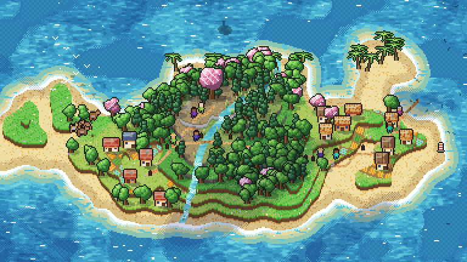
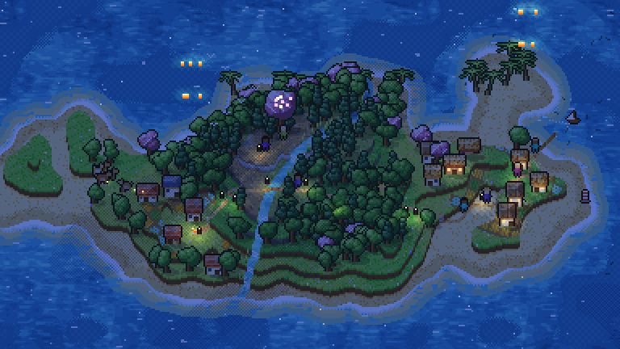
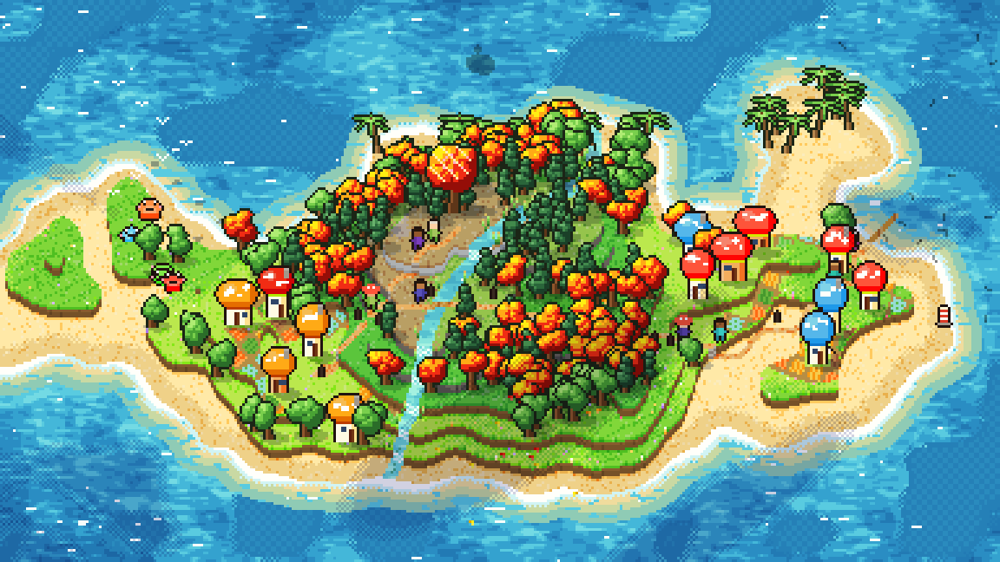
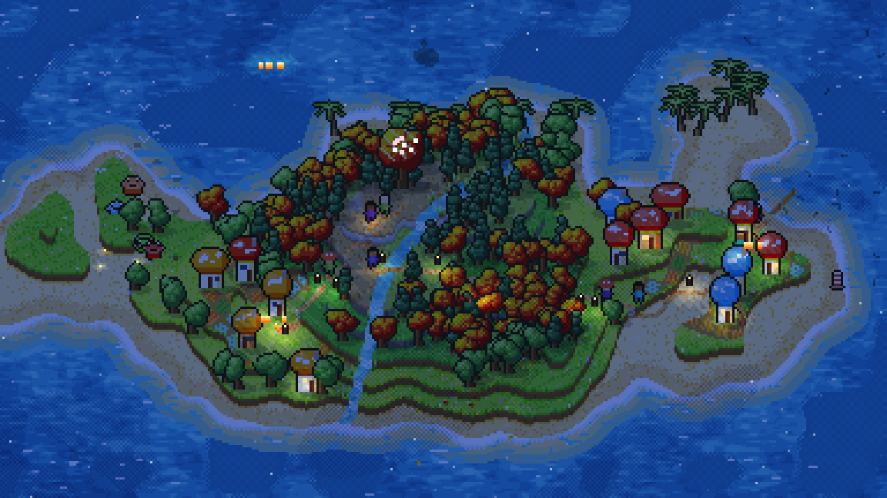
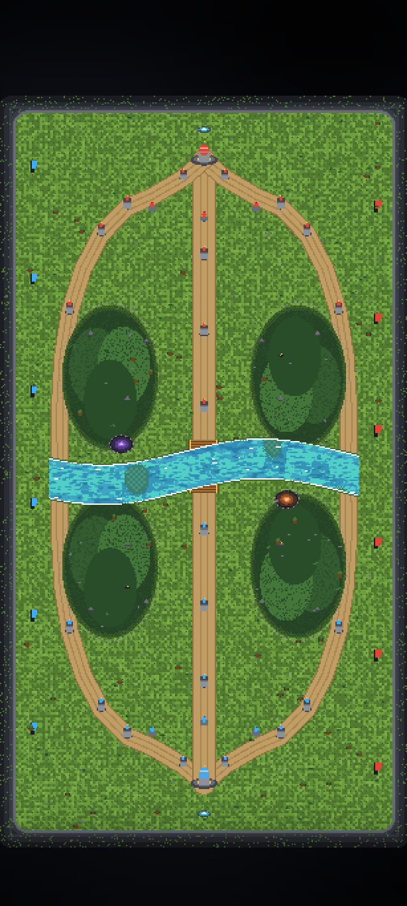
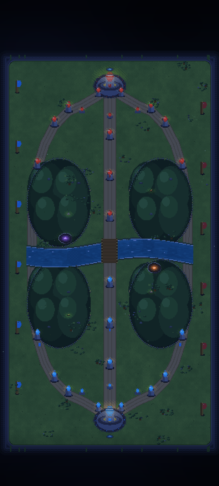

# Đảo sống — hình nền động viết bằng Kotlin





Một hòn đảo pixel được **sinh ra từ một cụm từ hạt giống**, rồi sống tiếp trên màn hình chính: nước chảy, thuyền
bơi, người đi trên đường, hươu gặm cỏ, hải âu lượn, đèn lồng sáng lên khi chiều xuống, và một ngày — đêm — bình minh
lặp lại mãi. Mọi pixel đều do code vẽ, **không có một file ảnh nào** trong app.

Đây là bản chuyển [ví dụ `examples/island`](../examples/island/) của repo
[procedural-almanac](../README.md) sang **Kotlin**, chạy như một **live wallpaper thật** (một `WallpaperService`),
không phải app mở lên rồi vẽ vào một canvas.

Cùng một hạt giống cho ra **cùng một hòn đảo** như bản chạy trên trình duyệt: hạt giống `heron-bay-8` sinh ra
13 nhà, 190 cây, 12 cây dừa, 34 khóm sậy, 11 đèn lồng, 3 con đường và ngọn hải đăng ở (362, 131) — giống từng con số.

### Giao diện "Làng Nấm Maple"





Cùng hòn đảo, cùng địa hình, cùng hạt giống — chỉ đổi lớp "da": **nhà nấm** kiểu Henesys (mũ tròn chấm trắng, thân
kem, cửa tròn, cửa sổ sáng khi tối), **rừng lá phong** đỏ–cam–vàng, **slime** nảy tưng tưng thay cho đàn hươu,
**lá phong rơi** lững lờ, người đi đường đội mũ nấm, và một tông màu ấm, rực hơn. Chọn trong app ở mục **Giao diện**.
Mọi sprite đều tự vẽ bằng code (lấy cảm hứng từ MapleStory, không dùng asset gốc của Nexon).

### Giao diện "Đảo Đôi Sông"





Không phải một hòn đảo khác, mà là **một bản đồ khác**: bản đồ đấu hai bên, dựng cho màn hình dọc.

- Hai căn cứ ở **đỉnh và đáy**, là ảnh quay 180° của nhau — cùng một nửa bản đồ, hai lần.
- **Đường giữa** chạy thẳng theo trục dọc, ngắn và rộng nhất: đó là xương sống của hình nền.
- **Hai đường biên** cong ra hai mép rồi nhập lại ở sông, dài gấp rưỡi đường giữa.
- **Sông** chạy ngang giữa bản đồ, chỉ có **một cây cầu** ở chỗ cắt đường giữa, hai con cua bò dưới nước.
- **Bốn khu rừng** hình chữ D, tường đá kín, đúng một cửa quay ra lane, lửa trại trong rừng sáng lên khi tối.
- **Hai hố quái lớn**: một tím ở bờ trên, một cam ở bờ dưới, đối nhau qua tâm.
- **18 trụ, 6 ức chế, 2 nhà chính**, mỗi bên 3 trụ một lane; lính hai màu đi ra theo đợt trên cả ba đường.
- Bản đồ chạy **sát mép** khung; hai dải trên/dưới — nơi điện thoại để đồng hồ và dock — được engine làm tối dần
  (một lớp `scrim`), nên chữ trắng của launcher vẫn đọc được mà không phải bỏ trống chỗ nào.

Bố cục này không vay từ bản đồ của game nào: nó là một bản đồ giả tưởng viết ra từ đặc tả
[`docs/rift-portrait-spec.md`](docs/rift-portrait-spec.md), và hình dáng từng lane, từng trụ nằm trong
`RiftPlan.kt` — toạ độ thuần, nên kiểm thử được bằng máy (đối xứng, mid ngắn nhất, sông cắt đúng một lần).

---

## Lấy APK (GitHub build hộ)

Không cần cài Android Studio hay JDK trên máy bạn:

1. Mở tab **Actions** của repo, chọn workflow **android**, bấm vào lần chạy mới nhất (workflow tự chạy mỗi lần có
   thay đổi trong `android/`, mỗi đêm, hoặc bấm **Run workflow** để chạy ngay).
2. Ở cuối trang, mục **Artifacts**, tải:
   - **`island-live-wallpaper`** — trong đó có `island-live-wallpaper-debug.apk` và `island-live-wallpaper-release.apk`
     (giải nén ra là cài được);
   - `island-still` — ảnh PNG do chính engine vẽ, để xem trước mà không cần điện thoại;
   - `test-report` — kết quả 13 bài kiểm tra của engine.
3. Bản release cũng được đính vào tab **Releases** khi bạn push một tag `v*` (ví dụ `git tag v1.0 && git push origin v1.0`).

Mỗi APK được ký bằng khoá debug nên cài thẳng lên máy là chạy; muốn ký bằng khoá riêng thì đặt các biến
`KEYSTORE_FILE`, `KEYSTORE_PASSWORD`, `KEY_ALIAS`, `KEY_PASSWORD` trong phần **Secrets** của repo.

## Cài và đặt làm hình nền

> Bản APK trên Actions được ký bằng khoá debug sinh ra trên máy chủ mỗi lần build, nên khi cài **đè** lên bản trước,
> Android có thể báo "Ứng dụng chưa được cài đặt". Gỡ bản cũ rồi cài lại là xong. Muốn cập nhật êm về sau, thêm
> `KEYSTORE_BASE64`/`KEYSTORE_PASSWORD`/`KEY_ALIAS`/`KEY_PASSWORD` vào Secrets và bật phần ký riêng trong
> `app/build.gradle.kts`.


1. Chép APK sang điện thoại và cài (cho phép "Cài từ nguồn không xác định" một lần).
2. Mở app **Island** → bấm **Đặt làm hình nền động** / *Set as live wallpaper*.
3. Hoặc tự làm: giữ lâu màn hình chính → **Hình nền** → **Hình nền động** → **Island**.
4. Android 8.0 trở lên (API 26). Không cần quyền nào, không có mạng, không quảng cáo, không thu thập gì.

## Dùng trong app

| Thứ | Làm gì |
| --- | --- |
| **Giao diện** | *Đảo gốc*, *Làng Nấm Maple* hoặc *Đảo Đôi Sông*. Đổi là vẽ lại ngay; hai giao diện đầu giữ nguyên địa hình, giao diện thứ ba là một bản đồ khác. |
| **Hạt giống** | Gõ bất cứ gì: `heron-bay-8`, `mua-he-3`, `42`. Số thì dùng thẳng số đó, chữ thì băm thành số. |
| **Ngẫu nhiên** | Bấm là ra hạt giống mới (một từ đầu + một từ cuối + số, ví dụ `amber-vale-7`) và đảo mọc lại ngay. |
| **Nhấn đúp lên hình nền** | Đổi sang một hạt giống ngẫu nhiên khác mà không cần mở app. |
| **Cỡ tranh** | *Tự động* (mặc định) tự đo tốc độ máy rồi chọn cỡ; hoặc ép *Nhỏ / Vừa / Lớn*. |
| **Số khung mỗi giây** | 24 (êm), 30 (mặc định), 60 (mượt, tốn pin hơn). |
| **Một ngày dài** | 5, 10, 20 hay 40 phút — chu kỳ ngày/đêm lặp lại vô hạn. |
| **Hình nền đang chạy** | Dòng trạng thái do chính hình nền ghi ra: hạt giống, số hiệu, cỡ tranh thật, số ms mỗi khung, fps, số nhà và cây. |

## Nhanh hơn bản trên trình duyệt ở đâu

| | Bản web (`examples/island`) | Bản Kotlin |
| --- | --- | --- |
| Một khung | ~0,85 giây (cả khung, kể cả chữ) | **~4 ms** ở 384×216, **~20 ms** ở 768×432 (JVM trên laptop) |
| Cỡ tranh | cố định 384×216 | máy tự chọn (mặc định ~210 000 pixel, ví dụ 307×682), đổi được tới 420 000 |
| Dựng đảo | ~0,5 giây mỗi lần đổi hạt giống | ~0,5 giây, **trên thread nền**, hình nền cũ vẫn chạy |
| Khi không nhìn thấy | vẫn vẽ | **dừng hẳn** (khoá màn hình, app khác che) |

Bốn điều làm nên tốc độ đó:

- **Nền tĩnh vẽ một lần.** Địa hình, ruộng, nhà, cây, đường, bóng đổ được vẽ vào một *khung nền* ngay khi đảo mọc
  xong; mỗi khung sau chỉ copy khung nền rồi vẽ phần động (nước, người, thú, chim, thuyền, ánh sáng theo giờ, đèn).
- **Mỗi vật đứng yên là một sprite dựng sẵn** — mỗi cây, mỗi nhà — thay vì vẽ lại từ đầu mỗi khung.
- **Blit nguyên bitmap.** Engine vẽ ở cỡ tranh của nó (vài trăm pixel), rồi đưa cả bitmap lên `Surface` một lần,
  không lọc, không nội suy: điện thoại không phải tô lại 1440 pixel cho mỗi pixel tranh, mà tranh vẫn sắc kiểu pixel.
- **Mỗi khung bắt đầu lại từ nền tĩnh** (cả ảnh lẫn bộ đệm độ sâu), nên hình nền chạy hàng giờ vẫn y như khung đầu:
  không có "vệt" của vật thể cũ ăn mòn vật thể mới — đây chính là lỗi làm người đi đường trông như bị chìm dưới đất.
- **Tự chỉnh trong chế độ Tự động.** Engine đo thời gian thật của từng khung; nếu khung vượt 70% ngân sách thời gian
  thì thu tranh nhỏ lại một nấc, nếu còn nhanh thì nới ra — tối đa mỗi giây một lần, nên nó ổn định chứ không giật.

## Cấu trúc

```
android/
  core/                       Kotlin thuần, không phụ thuộc Android
    src/main/kotlin/dev/almanac/island/
      Maths, Rng, Noise, Colour, Palette, Water, Shapes, Sprite,
      World, Relief, Light, IslandScene      ← engine, 1:1 với scene.js
      Theme.kt                               ← ORIGINAL / MAPLE / RIFT: chọn bảng màu, nhà, cây, thú
      LiveScene.kt                           ← thứ mà wallpaper nhìn thấy: một khung hình, một bước thời gian
      RiftPlan.kt                            ← RIFT: toạ độ của bản đồ (lane, trụ, hố, rừng), không vẽ gì
      RiftScene.kt                           ← RIFT: vẽ bản đồ đó, và cho lính đi
      preview/PreviewMain.kt                 ← vẽ ảnh PNG trên laptop/CI
    src/test/kotlin/dev/almanac/island/EngineTest.kt   ← 16 bài: so khớp với bản JS, và khung ổn định
  app/
    src/main/java/dev/almanac/island/wallpaper/
      IslandWallpaperService.kt   ← WallpaperService: vòng vẽ, đo tốc độ, nhấn đúp, nghe đổi cài đặt
      MainActivity.kt             ← màn hình cài đặt duy nhất
      Prefs.kt, SeedWords.kt
    src/main/res/                 ← layout, màu, drawable (toàn bộ bằng XML, không ảnh)
  gradlew, gradle/                ← Gradle 8.9 wrapper, build được ở CI
```

`core/` không có một dòng `android.*` nào, nên nó chạy được trên JVM thường: đó là lý do có thể kiểm tra engine
và vẽ ảnh ngay trong GitHub Actions, không cần máy ảo Android.

## Tự build

Cần JDK 17 và Android SDK 35 (`ANDROID_HOME`), hoặc cứ để GitHub Actions làm:

```bash
cd android
./gradlew :core:test                      # 13 bài kiểm tra engine
./gradlew :app:assembleDebug              # ra app/build/outputs/apk/debug/*.apk
./gradlew :core:preview --args="--seed heron-bay-8 --t 13.05 --fixed-day --tod 0.3 --out island.png --scale 2"
# giao diện Maple
./gradlew :core:preview --args="--seed heron-bay-8 --theme maple --t 13 --fixed-day --tod 0.3 --out maple.png --scale 3"
# giao diện Đảo Đôi Sông, đúng cỡ khung điện thoại dọc
./gradlew :core:preview --args="--seed twin-rivers-8 --theme rift --size 307x682 --tod 0.30 --out rift-day.png --scale 2"
```

`--tod` là giờ trong ngày (0..1: 0,3 là buổi sáng, 0,8 là đêm), `--scale 2` phóng to ảnh cho dễ nhìn.

## Kiểm thử

`EngineTest` không so engine với chính nó: mỗi con số kỳ vọng được lấy từ bản JavaScript trong `src/`, nên bài kiểm
tra bắt được lệch một bit. Nó phủ: băm và hạt giống, nhiễu value/fractal, `SeededRandom`, hình dạng đảo, đóng gói
màu `0xAARRGGBB`, pha màu (grade), nước, khoảng cách chamfer, tìm đường A*, mọc đảo thật (có pixel, có chuyển động,
cùng seed thì cùng đảo), khung dọc kiểu điện thoại, và cách sinh hạt giống từ hai danh sách từ.

## Ghi công và giấy phép

Engine là bản chuyển của [procedural-almanac](../README.md) — 162 kỹ thuật, mỗi kỹ thuật dẫn nguồn — theo giấy phép
MIT. Bản Kotlin này cũng dùng giấy phép MIT như repo mẹ.
